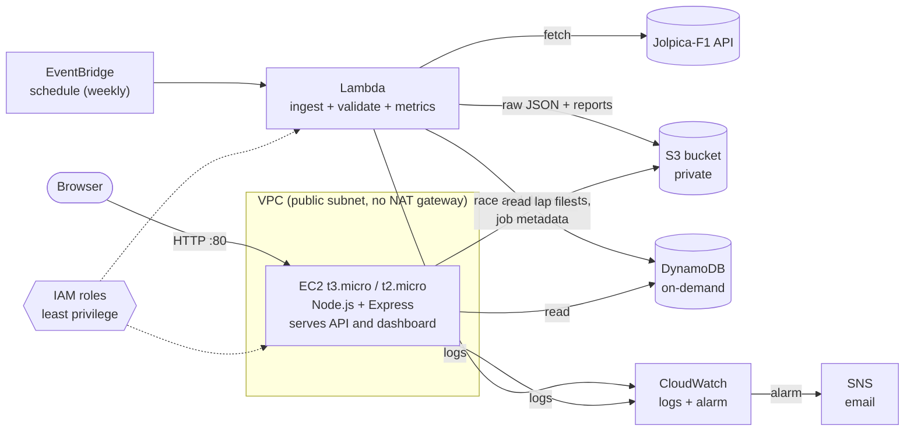

# Architecture

## Goal

Users pick a season or race and explore driver and constructor statistics from processed historical data. Processing runs on a schedule in AWS. The dashboard reads only processed data and never calls the public F1 API directly.

## Target AWS architecture



## What each service does (and why it's there)

| Service | Responsibility | Why not something else |
|---|---|---|
| **EC2** | Runs the Express API and serves the static dashboard | The brief requires a Node.js backend on EC2. One small instance does both jobs, so no load balancer is needed. |
| **VPC** | Network for EC2. Public subnet plus security group: port 80 (and 22 only from your IP) | The default VPC is enough. **No NAT gateway** (it costs money per hour); Lambda runs outside the VPC so it can reach the internet for free. |
| **IAM** | Instance role for EC2 (read S3 and DynamoDB), execution role for Lambda (write S3 and DynamoDB, write logs) | No access keys on the server or in Git |
| **S3** | Raw Jolpica downloads (`raw/<season>/…`), processed lap files, validation reports, CSV exports | Cheap for large or rarely read JSON. Keeps an audit trail of exactly what was fetched. |
| **DynamoDB** | Season summaries, race results, driver and constructor stats, processing-run metadata | Fast key lookups for the API. On-demand mode costs nothing when idle. |
| **Lambda** | Runs the same `processSeason()` code as the local scripts: fetch, validate, compute metrics, write to S3 and DynamoDB | Processing runs about once a week, so a pay-per-run function beats an always-on server |
| **EventBridge** | Triggers the Lambda on a schedule (for example Mondays 06:00 UTC, after race weekends) | Native cron for Lambda, no server needed |
| **CloudWatch** | Lambda and EC2 logs, an alarm on Lambda `Errors`, short log retention | Built-in metrics only, no custom metrics |
| **SNS** | Emails the team when processing fails (and optionally when it succeeds) | Simplest way to get an alarm to an inbox |

## Data flow

1. EventBridge fires the processing Lambda with `{ "season": 2025 }` (or the current season by default).
2. Lambda downloads raw data from Jolpica, respecting the rate limit, and saves it unchanged to `s3://<bucket>/raw/<season>/`.
3. Lambda validates and cleans the data. Bad rows are dropped and recorded, and computed points are checked against the official standings.
4. Lambda computes metrics and writes:
   - season summary, standings, driver and constructor stats → DynamoDB
   - lap files and the validation report → `s3://<bucket>/processed/<season>/`
   - a run record (status, counts, duration) → DynamoDB
5. The Express API on EC2 reads from DynamoDB and S3 through the data-store interface and serves the dashboard.
6. Errors go to CloudWatch Logs. An alarm on the Lambda error metric notifies the SNS topic, which emails the team.

## Code layout and the data-store seam

```
processing/src/   validate.js, metrics.js, processSeason.js   pure logic, shared by CLI and Lambda
processing/scripts/ ingest.js, process.js                     local CLI (writes data/raw, data/processed)
backend/src/data/  index.js picks a store from DATA_STORE
                   localStore.js reads data/processed/ (works today)
                   s3Store.js / dynamoStore.js                 same 4 methods, read from AWS
processing/src/awsLayout.js                                    DynamoDB item and S3 key layout (pure functions)
processing/scripts/upload.js                                   pushes data/processed/ into S3 and DynamoDB
backend/src/       app.js, routes/api.js, validate.js         Express API and input validation
frontend/          index.html, css/, js/                      static dashboard (Chart.js)
```

Every store implements `listSeasons()`, `getSeason(season)`, `getLaps(season, round)` and `getReport(season)`. The routes don't know where data comes from, so switching data source is just the `DATA_STORE` setting:

| `DATA_STORE` | Reads from | Also needs |
|---|---|---|
| `local` (default) | `data/processed/` on disk | |
| `s3` | the S3 bucket | `S3_BUCKET` |
| `dynamodb` | season data from DynamoDB; laps and reports from S3 | `DDB_TABLE`, `S3_BUCKET` |

`AWS_REGION` is optional for both AWS stores. Credentials come from the default AWS provider chain (the instance role on EC2). Both AWS stores cache reads for 5 minutes, so a new processing run shows up without a restart. A missing object returns "not found"; any other error (for example AccessDenied) surfaces as a server error.

Upload local data with `npm run upload -- 2024 [--only s3|dynamodb] [--dry-run]`.

## DynamoDB design (single table, on-demand)

The layout is implemented in `processing/src/awsLayout.js`; the upload script and `dynamoStore` both use it, and so should anything else that writes to the table. Every item keeps its payload in a `data` attribute.

| PK | SK | `data` holds |
|---|---|---|
| `SEASON#2024` | `SUMMARY` | everything in `season.json` except `races` and `driverStats`: standings, progression, constructor stats, driver and constructor names |
| `SEASON#2024` | `RACE#05` | one race: results, qualifying, sprint, qualifying gaps (round zero-padded to 2 digits) |
| `SEASON#2024` | `DRIVER#norris` | that driver's season stats (item also has `idx`, the original order) |
| `SEASONS` | `2024` | season index entry (`updatedAt` attribute) |
| `RUN#2024` | `<ISO timestamp>` | processing-run record: status, counts, duration, error (written by the Lambda, not by the upload script) |

`getSeason` is one Query on `PK = SEASON#2024`. About 50 items and 50 KB for a full season; the largest item is about 13 KB.

Lap files stay in S3 because a full race of laps can pass DynamoDB's 400 KB item limit.

## S3 layout

```
processed/<year>/season.json
processed/<year>/report.json
processed/<year>/laps/<round>.json
raw/<year>/...                       raw Jolpica downloads (written by the Lambda)
```

There is no index file. The list of seasons is the set of `processed/<year>/` folders, so two writers can never overwrite each other's list.

## IAM permissions the data layer needs

- Reader (EC2 instance role): `s3:GetObject` on `processed/*`; `s3:ListBucket` on the bucket with prefix `processed/*` (without it S3 answers a missing key with AccessDenied instead of not found); `dynamodb:GetItem` and `dynamodb:Query` on the table.
- Writer (upload script, Lambda role): `s3:PutObject` on `processed/*` (and `raw/*` for the Lambda); `dynamodb:PutItem` and `dynamodb:BatchWriteItem` on the table.

## Security decisions

- No credentials in code or Git. AWS access comes from IAM roles only. `.gitignore` blocks `.env`, keys and `.aws/`.
- API inputs are validated (season, round, driver ids) before any lookup. Errors return a generic message without stack traces.
- Security headers on every response, including a Content-Security-Policy that only allows scripts from the app itself. Chart.js is served locally, not from a CDN.
- The S3 bucket stays private with Block Public Access on. The browser never talks to S3 or DynamoDB directly.
- No personal or financial data is collected. There are no user accounts.

## Cost notes (re-check pricing before creating anything)

- EC2: use a free-tier-eligible instance type for your account and **stop it when you're not demoing**. AWS bills public IPv4 addresses by the hour; check whether your account's free tier covers it.
- No NAT gateway, no load balancer, no Elastic IP left unattached.
- DynamoDB on-demand, S3 Standard with small files, Lambda a few runs per week: expected to stay within free allowances, but verify for your account type.
- CloudWatch: set log retention (for example 7 days) and use one alarm.
- Create an AWS Budgets alert (for example $5) before anything else.
